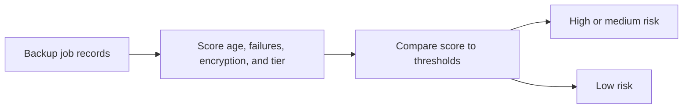

# Backup Job Risk Scorer

An operator reviewing multiple backup jobs needs to prioritize stale or repeatedly failed protection for critical workloads.

[Skills and verification](docs/ENGINEERING_NOTES.md)

## What I built

I built a backup review queue that scores each job using age since last success, failures in the last 24 hours, encryption status, and workload tier. The CLI returns both the score and the low, medium, or high classification.

## How it works



[Architecture](docs/ARCHITECTURE.md) · [Decision rules and source](docs/RULES.md)

## Tools used

| Tool | Role in this repository |
| --- | --- |
| Python | [backup_risk.py](backup_risk.py) implements the CLI and decision rules. Uses `csv` to read tabular exports. |
| Make | Runs the documented example and the local `unittest` suite. |
| Python replay runner | Compares actual stdout with the checked-in baseline fixtures. |
| Ruff and Bandit | Developer lint and static security checks through `make check`. |

## Run the project

Use Python 3.10+ and Make. From the repository root:

```sh
python3 backup_risk.py sample_backups.csv
```

The CRM database scores 12 and is high risk. The wiki scores zero and is low risk. [Full expected output](examples/Demo%201.stdout.txt)

### Additional replay cases

- **Last sample record in isolation** · `python3 backup_risk.py examples/last-record.csv` · [Expected output](examples/Last%20sample%20record%20in%20isolation.stdout.txt)

## Verify the project

```sh
make verify
make replay
```

`make replay` checks the recorded cases and exits nonzero if the output changes.
See the [developer guide](docs/DEVELOPMENT.md) for the pinned lint and security tools.

## Operating limits

A classification reflects the supplied export and policy weights. Verify actual recoverability with a restore drill.

[Case study](docs/CASE_STUDY.md) · [Operator runbook](docs/RUNBOOK.md) · [Verification report](reports/verification.md)
